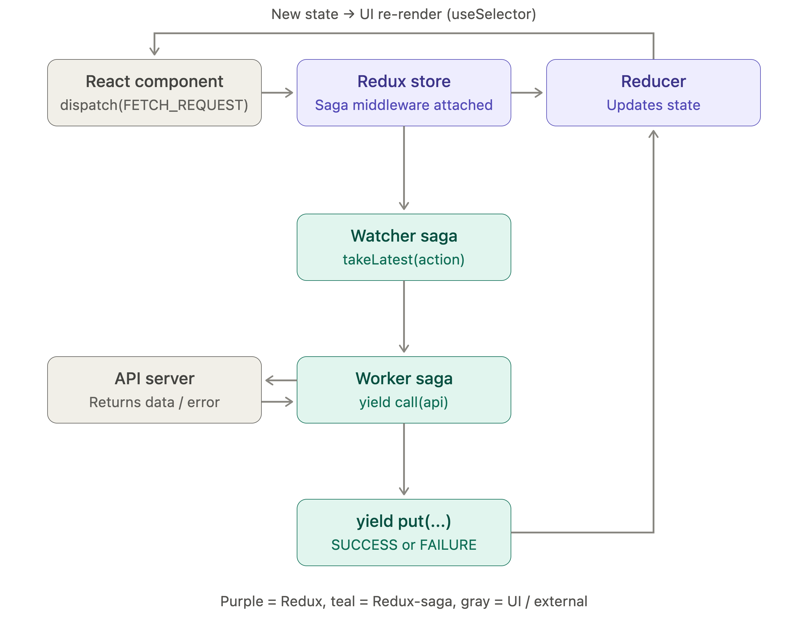

# Redux কী?

Redux হলো একটি state management library। “State” মানে অ্যাপের ডেটা, যেমন: user logged in কিনা, cart-এ কয়টা item আছে, কোন theme চালু আছে।

## সমস্যাটা কী ছিল?

React-এ প্রতিটি component-এর নিজস্ব state থাকে। কিন্তু অনেক component-এর একই ডেটা দরকার হলে (যেমন Navbar, Cart page, Checkout page সবারই cart-এর ডেটা লাগে), তখন props দিয়ে ডেটা এক component থেকে আরেক component-এ নামাতে হয়। একে বলে **prop drilling**, আর অ্যাপ বড় হলে এটা জটিল হয়ে যায়।

## Redux-এর সমাধান

পুরো অ্যাপের shared ডেটা একটি কেন্দ্রীয় জায়গায় রাখা হয়, যাকে বলে **Store**। যেকোনো component সরাসরি store থেকে ডেটা নিতে পারে।

একটা উদাহরণ ভাবুন: Store হলো একটি ব্যাংক। আপনি সরাসরি ভল্টে ঢুকে টাকা নিতে পারেন না। আপনাকে একটি ফর্ম (**action**) পূরণ করে জমা দিতে হয়, তারপর ক্যাশিয়ার (**reducer**) নিয়ম মেনে আপনার হিসাব আপডেট করে।

## Redux-এর ৪টি মূল অংশ

### ১. Store
পুরো অ্যাপের state যেখানে থাকে। একটি অ্যাপে একটাই store।

### ২. Action
একটি সাধারণ JavaScript object, যেটা বলে "কী ঘটেছে"। এতে অবশ্যই একটি `type` থাকে, সাথে ডেটা থাকলে `payload`।

```javascript
{ type: 'ADD_TO_CART', payload: { id: 1, name: 'বই' } }
```

### ৩. Reducer
একটি function, যেটা পুরনো state ও action নিয়ে নতুন state ফেরত দেয়। এটি অবশ্যই **pure function** হতে হবে, মানে একই input দিলে সবসময় একই output, এবং এর ভেতরে API call, timer বা random কিছু করা যাবে না।

```javascript
function cartReducer(state = [], action) {
  switch (action.type) {
    case 'ADD_TO_CART':
      return [...state, action.payload];
    default:
      return state;
  }
}
```

### ৪. Dispatch
Action-কে store-এ পাঠানোর মাধ্যম।

```javascript
dispatch({ type: 'ADD_TO_CART', payload: { id: 1, name: 'বই' } });
```

## Redux-এর ডেটা প্রবাহ

Redux-এ ডেটা সবসময় একদিকে (one-way) চলে:



React-এ এই কাজগুলো হয় দুটি hook দিয়ে: `useDispatch()` দিয়ে action পাঠানো হয়, আর `useSelector()` দিয়ে store থেকে ডেটা পড়া হয়।

## সমস্যা: API call কোথায় করব?

এখন ধরুন, user একটি বাটনে click করলে সার্ভার থেকে product list আনতে হবে। এটা কোথায় লিখবেন?

- **Reducer-এ** লেখা যাবে না, কারণ reducer pure হতে হবে এবং তাৎক্ষণিক নতুন state ফেরত দিতে হবে। API call সময় নেয়, ব্যর্থও হতে পারে। এই ধরনের কাজকে বলে **side effect**: API call, setTimeout, localStorage-এ লেখা, WebSocket ইত্যাদি।
- **Component-এর ভেতরে** লেখা যায়, কিন্তু তখন UI কোড আর business logic মিশে যায়, এবং একই logic বিভিন্ন component-এ বারবার লিখতে হয়।

এখানেই আসে **middleware**। Middleware হলো dispatch আর reducer-এর মাঝখানে বসা একজন "মধ্যস্থতাকারী", যে action reducer-এ পৌঁছানোর আগে বা পরে অতিরিক্ত কাজ করতে পারে।

## Redux-saga কী?

Redux-saga হলো এমন একটি middleware, যেটা side effect সামলানোর জন্যই তৈরি। “Saga” শব্দের অর্থ দীর্ঘ কাহিনি, অর্থাৎ ধাপে ধাপে চলা একটি প্রক্রিয়া।

ব্যাংকের উদাহরণে ফিরে যাই: ক্যাশিয়ার (reducer) শুধু হিসাব আপডেট করে, বাইরে যায় না। কিন্তু ধরুন অন্য ব্যাংক থেকে টাকা আনতে হবে। তখন একজন আলাদা কর্মচারী (**saga**) সেই কাজ করে: ফর্ম দেখে বাইরে যায়, টাকা নিয়ে আসে, তারপর ক্যাশিয়ারকে নতুন ফর্ম দেয় "টাকা এসেছে, হিসাব আপডেট করো"।

Saga-তে দুই ধরনের function থাকে:

- **Watcher saga** সবসময় নির্দিষ্ট একটি action-এর জন্য পাহারা দেয়, যেমন "কেউ `FETCH_PRODUCTS` পাঠালেই আমাকে জানাও"।
- **Worker saga** আসল কাজটা করে: API call করে, তারপর ফলাফল অনুযায়ী নতুন action (`SUCCESS` বা `FAILURE`) dispatch করে।

```javascript
import { call, put, takeLatest } from 'redux-saga/effects';

function* fetchProductsWorker() {
  try {
    const data = yield call(api.getProducts);   // API call, অপেক্ষা
    yield put({ type: 'FETCH_SUCCESS', payload: data }); // নতুন action
  } catch (e) {
    yield put({ type: 'FETCH_FAILURE', error: e.message });
  }
}

function* watcher() {
  yield takeLatest('FETCH_PRODUCTS', fetchProductsWorker);
}
```

এখানে `function*` হলো **generator function**, আর `yield` মানে "এখানে থামো, কাজ শেষ হলে আবার চলো"। এ কারণে async কোড পড়তে সাধারণ ধাপে ধাপে লেখা কোডের মতো লাগে।

## সংক্ষেপে মনে রাখুন

- Redux অ্যাপের state এক জায়গায় রাখে এবং নিয়ম মেনে বদলায়।
- Reducer শুধু হিসাব করে, বাইরের কোনো কাজ করে না।
- Redux-saga সেই "বাইরের কাজগুলো" (API call ইত্যাদি) আলাদাভাবে, পরিষ্কারভাবে সামলায়।

আমার আগের উত্তরে যে বড় diagram আর সম্পূর্ণ উদাহরণ দিয়েছিলাম, সেটা এখন আবার দেখলে আরও পরিষ্কার বোঝা যাবে। এরপর চাইলে React component থেকে কীভাবে action dispatch করতে হয়, সেটা বিস্তারিত দেখাতে পারি।
